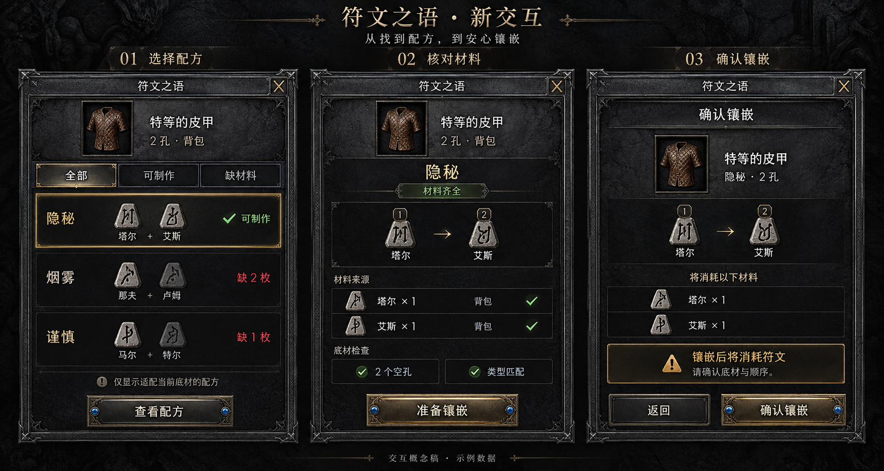

# 高保真设计参考图 · Design Reference

把需求脑洞或现有界面的改版想法，做成精美专业、便于评审和二次开发的设计参考图。完整工作流程见 [SKILL.md](SKILL.md)。

## 效果示例：符文之语新交互

下面是使用本技能配合图像生成工具制作的概念参考图。基于已有游戏界面的暗黑石材与旧金属视觉语言，将新交互拆成 **选择配方 → 核对材料 → 确认镶嵌** 三步，让用户直观看到功能如何使用。

[查看原尺寸图片](assets/runeword-interaction.png)

这是一张生成式交互概念稿，使用示例数据；不是已经实现或测试的游戏界面，也不是符文图标、配方或游戏规则的权威依据。原始输入截图不随技能分发。

## 如何使用

提供自己的参考截图，并说明要解决的问题、允许修改的范围，以及需要保留的内容。例如：

> 使用 $design-reference，根据我的符文之语界面截图，设计一版“选择配方 → 核对材料与底材 → 确认镶嵌”的新交互。保留暗黑石材和旧金属风格，中文清楚，做成精美专业的三步对照参考图。

同样的方法也适用于应用、网站和其他游戏界面。示例展示的是交付形式与视觉完成度；具体风格和交互应服从用户当次需求。
